# Awesome Cloud Data Migration 🚀☁️

  

  
  
  
  
  
  

---

## 🌟 Overview & Highlights

> **Curated Directory of Cloud Data Migration, ELT/ETL Pipelines, CDC Replication & Data Movement Tools**
>
> *Comprehensive guide covering managed enterprise SaaS platforms, hyperscaler migration engines, and self-hosted open-source frameworks. Updated for 2026.*

Modern data architectures require moving terabytes to petabytes of operational data from disparate on-premises relational databases, SaaS platforms, and distributed event streams into unified cloud data warehouses (Snowflake, BigQuery, Redshift), modern lakehouses (Apache Iceberg, Delta Lake), and AI agent knowledge bases. This repository provides data engineers, architects, and DevOps leads with an objective comparison of **enterprise SaaS platforms** and **open-source tools**.

---

## 📑 Table of Contents

- [📊 Sector Overview & Market Dynamics](#-sector-overview--market-dynamics)
- [🏢 SaaS & Hosted Cloud Migration Platforms](#-saas--hosted-cloud-migration-platforms)
- [🔓 Open-Source GitHub Projects](#-open-source-github-projects)
  - [1. Rclone](#1-rclone)
  - [2. Airbyte](#2-airbyte)
  - [3. Debezium](#3-debezium)
  - [4. Redpanda Connect](#4-redpanda-connect)
  - [5. Apache SeaTunnel](#5-apache-seatunnel)
  - [6. CloudQuery](#6-cloudquery)
  - [7. Apache NiFi](#7-apache-nifi)
  - [8. dlt (data load tool)](#8-dlt-data-load-tool)
  - [9. Meltano](#9-meltano)
  - [10. Apache Hop](#10-apache-hop)
- [⚙️ Architectural Archetypes: Choosing the Right Tool](#️-architectural-archetypes-choosing-the-right-tool)
- [🤝 How to Contribute](#-how-to-contribute)
- [💖 Support & Sponsorship](#-support--sponsorship)
- [📈 Star History](#-star-history)
- [⚖️ Disclaimer](#️-disclaimer)

---

## 📊 Sector Overview & Market Dynamics

The global data integration and cloud data migration market is estimated at approximately **$15B–$20B** (with the broader cloud migration services ecosystem projected to surpass **$200B+** by the early 2030s, expanding at a ~23–25% CAGR). 

The market exhibits **moderate fragmentation**: while foundational cloud infrastructure and baseline database migration utilities are concentrated among hyperscalers (Amazon Web Services, Microsoft Azure, Google Cloud), the application-level data integration, ELT, and iPaaS ecosystem remains highly dynamic and competitive. Specialized independent SaaS vendors and active open-source ecosystems flourish to address multi-cloud architectures, real-time CDC replication, and vendor lock-in avoidance.

---

## 🏢 SaaS & Hosted Cloud Migration Platforms

| Platform | Company Size (Valuation / Revenue) | Pricing (Starting Tier) | Free Tier / Trial Limits | Description & Best For |
| :--- | :--- | :--- | :--- | :--- |
| **[Azure Data Factory](https://azure.microsoft.com/en-us/products/data-factory)** | **Microsoft**: ~$3.9T Market Cap / ~$331.8B Rev | Pay-as-you-go: ~$1.00 per 1,000 cloud activity runs; ~$0.25 per DIU-hour for data movement | **First 5 low-frequency activities/month free** (running <= 1/day); 30-day $200 Azure trial credits | Fully managed cloud data integration service with 90+ connectors and visual pipeline design. Best for Microsoft Azure-native environments. |
| **[AWS Database Migration Service (DMS)](https://aws.amazon.com/dms/)** | **Amazon (AWS)**: ~$2.6T Market Cap / ~$717B Rev | Provisioned: `dms.t3.micro` from ~$0.018/hr; Serverless from ~$0.082 per DCU-hour | **750 hours/month** of Single-AZ `dms.t3.micro` + 50 GB storage free for 12 months on AWS Free Tier | Managed database migration and ongoing CDC replication into RDS, Aurora, and Redshift. Best for AWS-centric workloads. |
| **[Atlassian Cloud Migration Assistant](https://www.atlassian.com/)** | **Atlassian**: ~$57B Market Cap / ~$6.57B Rev | Migration tool is **Free**; Atlassian Cloud Standard starts at ~$7.75/user/month (Jira) | **Free forever plan up to 10 users & 2 GB storage** per product (or matching-duration Cloud Migration Trial) | Specialized native migration tooling (JCMA, CCMA) for transitioning Jira/Confluence Server or Data Center workloads to Atlassian Cloud. |
| **[Qlik Replicate](https://www.qlik.com/)** | **Qlik**: ~$10B Valuation / ~$750M–$1B Rev | Enterprise contracts start at ~$1,000/month (quote-based per endpoint/volume) | **No self-service free tier or trial** (custom sales PoC and guided demo upon request) | High-throughput enterprise Change Data Capture (CDC) and streaming replication supporting mainframe, SAP, and legacy enterprise databases. |
| **[Informatica Cloud (IDMC)](https://www.informatica.com/)** | **Informatica**: ~$7.6B Market Cap / ~$1.6B Rev | Usage-based via IPUs (Informatica Processing Units) starting ~$90–$100/IPU/month; entry contracts ~$50K/year | **25 IPUs/month free** on Cloud Data Integration Free Service; or **30-day free trial** with access to IDMC modules | Enterprise-grade iPaaS offering comprehensive data cataloging, governance, mass ingestion, and ETL/ELT pipelines for complex enterprise environments. |
| **[Fivetran](https://www.fivetran.com/)** | **Fivetran**: ~$5.6B Valuation / ~$300M+ ARR | Standard plan starts at ~$500 per million Monthly Active Rows (MAR) + $5/connection base | **500,000 MAR/month free forever** (+ 3,500 reverse ETL rows & 5,000 dbt runs); 14-day free trial with unlimited MAR | Automated zero-maintenance ELT pipeline with 700+ connectors and schema drift management into modern cloud warehouses. |
| **[Talend (Qlik Talend Cloud)](https://www.talend.com/)** | **Qlik / Talend**: ~$2.4B Acq. / ~$350M Rev | Starter tiers start at ~$300/month (billed annually); full enterprise packages scale from ~$50K+/year | **14-day free trial** with pipeline capacity testing limits (Talend Open Studio retired) | Heavy-duty enterprise data integration, API services, and data quality/governance engine. |
| **[Airbyte Cloud](https://airbyte.com/)** | **Airbyte**: ~$1.5B Valuation | Standard tier starts at base ~$10–$20/month; usage at ~$2.50–$5.00 per credit (Open-source self-hosted is free) | **14-day free trial** including **400 free trial credits** (~100 GB data transfer, no credit card required) | Managed version of the leading open-source ELT platform with 600+ pre-built connectors and no-code Connector Builder. |
| **[Matillion](https://www.matillion.com/)** | **Matillion**: ~$1.5B Valuation / ~$100M ARR | Consumption-based starting at ~$2.00–$3.50 per credit (Teams tier starts at ~$1,000/month) | **14-day free trial** including **500 free credits** for 1 developer user (Developer tier) | Cloud-native pushdown ELT/ETL platform running transformation compute directly inside Snowflake, Databricks, Redshift, and BigQuery. |
| **[Stitch](https://www.stitchdata.com/)** | **Qlik / Talend**: ~$60M Acq. by Talend | Standard plan starts at **$100/month** for 5 million monthly rows (scales up with volume) | **14-day free trial** with **unlimited row replication** (no credit card required) | Developer-friendly, lightweight ELT data pipeline tool focused on fast, straightforward ingestion from SaaS and database sources. |

---

## 🔓 Open-Source GitHub Projects

The open-source data migration ecosystem delivers battle-tested tools ranging from raw cloud-storage file sync utilities and distributed streaming CDC engines to modular Python-first ELT libraries. Below is the curated list of top open-source projects, **sorted by GitHub_Stars_Count in descending order**:

### 1. [Rclone](https://github.com/rclone/rclone) 
* **Description**: *"rsync for cloud storage"* — the gold standard multi-cloud sync, migration, and transfer command-line program.
* **Key Features**: Supports **70+ cloud storage providers** including AWS S3, Google Cloud Storage, Azure Blob, Google Drive, Backblaze B2, SFTP, and WebDAV; multi-threaded transfers; chunked uploads; end-to-end checksum verification; bandwidth limits; file encryption (crypt); and bidirectional folder synchronization.
* **Tech Stack & License**: Go | MIT License.
* **Deployment**: Single standalone binary, Docker container, or Kubernetes cron/daemon.
* **Best For**: Migrating multi-terabyte to petabyte unstructured object storage, buckets, datasets, and file systems across cloud providers with zero licensing fees.

### 2. [Airbyte](https://github.com/airbytehq/airbyte) 
* **Description**: Leading open-source data integration platform for ELT pipelines and unified data movement.
* **Key Features**: **600+ pre-built connectors** across databases, SaaS APIs, warehouses, and data lakes; low-code Connector Development Kit (CDK) and no-code visual Connector Builder; built-in Airbyte Agents and Agent SDK (`airbyte-agent-sdk`) for feeding real-time context to LLMs; scheduling and orchestration via REST API, Airflow, Dagster, and Prefect.
* **Tech Stack & License**: Java & Python | ELv2 / MIT.
* **Deployment**: Self-hosted on Docker, Kubernetes (Helm), or Airbyte Cloud.
* **Best For**: Engineering teams wanting a self-hosted Fivetran alternative with the broadest connector ecosystem and automated schema synchronization.

### 3. [Debezium](https://github.com/debezium/debezium) 
* **Description**: The industry-standard distributed platform for real-time **Change Data Capture (CDC)**.
* **Key Features**: Streams row-level database changes (`INSERT`, `UPDATE`, `DELETE`) by tailing transaction log commits from MySQL, PostgreSQL, Oracle, Microsoft SQL Server, MongoDB, and Db2; sub-millisecond data replication latency; exact-once semantics with Kafka; built-in Debezium Server for running without full Kafka Connect clusters.
* **Tech Stack & License**: Java | Apache 2.0.
* **Deployment**: Kafka Connect plugin, Debezium Server standalone runner, or Kubernetes (Strimzi).
* **Best For**: Zero-downtime database migrations, microservice synchronization, and low-latency continuous data streaming into cloud destinations.

### 4. [Apache SeaTunnel](https://github.com/apache/seatunnel) 
* **Description**: Distributed, ultra-high-performance data integration platform capable of synchronizing massive volumes of data daily.
* **Key Features**: **100+ connectors**; unified batch and stream processing engine; high-throughput CDC replication; distributed two-phase commit and snapshot algorithms guaranteeing data consistency; dynamic multi-engine runtime (SeaTunnel Zeta Engine, Apache Flink, Apache Spark); multi-table sync with JDBC multiplexing.
* **Tech Stack & License**: Java | Apache 2.0.
* **Deployment**: Distributed SeaTunnel Zeta cluster, Spark/Flink runner, or Kubernetes.
* **Best For**: High-throughput enterprise data pipelines, petabyte-scale data synchronization, and consolidating batch and CDC pipelines into a single framework.

### 5. [Redpanda Connect](https://github.com/redpanda-data/connect) 
* **Description**: High-performance stream processor and data pipeline utility (formerly *Benthos*).
* **Key Features**: **200+ connectors** for message brokers, cloud storage, SaaS endpoints, and document stores; declarative stateless YAML stream configurations; ultra-low memory footprint; built-in mapping language (Bloblang) for instant payload schema transformations and filtering without JVM overhead.
* **Tech Stack & License**: Go | MIT License.
* **Deployment**: Lightweight static binary, Docker, or Kubernetes sidecar/pod.
* **Best For**: Blazing-fast event streaming, API data ingestion, lightweight CDC routing, and moving streaming events into S3/Snowflake/BigQuery without managing heavy cluster infrastructure.

### 6. [CloudQuery](https://github.com/cloudquery/cloudquery) 
* **Description**: High-performance, open-source ELT framework designed specifically for cloud infrastructure, APIs, and security configurations.
* **Key Features**: Extracts configuration, state, and assets from cloud providers (AWS, Azure, GCP), Kubernetes, GitHub, and SaaS tools, loading them directly into SQL databases (PostgreSQL, Snowflake, BigQuery); concurrency-driven architecture; custom plugin SDK in Go, Python, and JavaScript.
* **Tech Stack & License**: Go | MPL 2.0.
* **Deployment**: Standalone CLI binary, Docker, or CI/CD pipelines.
* **Best For**: Cloud infrastructure audit, cross-cloud compliance data migration, asset inventory ingestion, and infrastructure-as-data pipelines.

### 7. [Apache NiFi](https://github.com/apache/nifi) 
* **Description**: Enterprise-grade dataflow system providing visual routing, transformation, and system mediation logic.
* **Key Features**: Web-based visual flowchart canvas; end-to-end data provenance and audit trail tracing each record's journey; fine-grained backpressure regulation; buffer prioritization; horizontal clustering; native Python processor extensions; TLS, SAML, and OIDC enterprise security.
* **Tech Stack & License**: Java | Apache 2.0.
* **Deployment**: Clustered on-premise VMs, AWS EC2, or Kubernetes.
* **Best For**: Highly regulated environments (finance, healthcare, defense) requiring complete data lineage, visual control over complex routing, and multi-protocol mediation.

### 8. [dlt (data load tool)](https://github.com/dlt-hub/dlt) 
* **Description**: Modern, library-first Python framework for building reliable and declarative data pipelines.
* **Key Features**: Embeddable via `pip install dlt`; automatic schema inference, typing, and dynamic schema drift handling; native support for 20+ destinations (DuckDB, Snowflake, BigQuery, Redshift, Iceberg, Delta Lake, Postgres); built-in incremental loading, state persistence, and merge strategies; AI-agent friendly pipeline scaffolding.
* **Tech Stack & License**: Python | Apache 2.0.
* **Deployment**: Embedded directly in Python apps, AWS Lambda, Airflow DAGs, Modal, or Google Cloud Run.
* **Best For**: Python data engineers and AI application developers who want clean, testable, Git-versioned pipelines inside their existing code repository without operating an external ETL cluster.

### 9. [Meltano](https://github.com/meltano/meltano) 
* **Description**: The declarative, CLI-driven "GitLab of data" bringing DevOps and CI/CD best practices to ELT.
* **Key Features**: Singer-standard extractor and loader ecosystem (500+ community taps and targets); pipelines declared in version-controlled `meltano.yml` manifests; integrated dbt transformations; environment-based configuration management (dev, staging, prod); native Airflow and Docker deployment generation.
* **Tech Stack & License**: Python | MIT License.
* **Deployment**: Self-hosted CLI runner in Docker, GitHub Actions, or Kubernetes.
* **Best For**: Teams committed to Infrastructure-as-Code (IaC), GitOps workflows, Singer ecosystem connectors, and pairing ELT with dbt Core.

### 10. [Apache Hop](https://github.com/apache/hop) 
* **Description**: Next-generation data integration and visual metadata-driven orchestration platform (forked and modernized from Kettle/Pentaho).
* **Key Features**: Hop Gui for visual pipeline and workflow composition; complete separation of metadata and runtime execution; pluggable execution engines (Hop Local, Apache Spark, Apache Flink); Git version control integration directly in the GUI; comprehensive testing frameworks for pipelines.
* **Tech Stack & License**: Java | Apache 2.0.
* **Deployment**: Standalone desktop GUI, Hop Server container, or Spark/Flink cluster.
* **Best For**: Organizations modernizing legacy Pentaho/Kettle workflows who desire visual drag-and-drop pipeline construction backed by modern containerized engines.

---

## ⚙️ Architectural Archetypes: Choosing the Right Tool

| Need / Use Case | Recommended Open-Source Solution | Recommended SaaS / Managed Solution | Key Trade-Off |
| :--- | :--- | :--- | :--- |
| **Object & File Storage Migration** (S3, GCS, Azure Blob, SFTP) | **[Rclone](https://github.com/rclone/rclone)** | **AWS DataSync / Azure Storage Mover** | Zero software licensing costs vs. fully managed cloud service SLAs |
| **Broad SaaS & API Connectors** (Salesforce, Stripe, HubSpot) | **[Airbyte](https://github.com/airbytehq/airbyte)** | **[Fivetran](https://www.fivetran.com/) / [Airbyte Cloud](https://airbyte.com/)** | Self-managed infrastructure maintenance vs. consumption costs per active row |
| **Real-Time CDC Database Migration** (PostgreSQL, MySQL, Oracle, SQL Server) | **[Debezium](https://github.com/debezium/debezium) / [Apache SeaTunnel](https://github.com/apache/seatunnel)** | **[AWS DMS](https://aws.amazon.com/dms/) / [Qlik Replicate](https://www.qlik.com/)** | Requires Kafka/JVM operational management vs. turn-key enterprise replication |
| **Code-Native Python Pipelines & AI Agents** | **[dlt](https://github.com/dlt-hub/dlt)** | **[Matillion](https://www.matillion.com/)** | You manage orchestration (Airflow/Dagster) vs. all-in-one GUI workflow portal |
| **Enterprise Data Lineage & Visual Mediation** | **[Apache NiFi](https://github.com/apache/nifi)** | **[Informatica Cloud](https://www.informatica.com/)** | Heavy cluster and state ops vs. high annual enterprise contract commitments |

---

## 🤝 How to Contribute

Contributions are warmly welcomed! Help keep this directory current, accurate, and valuable for the global data engineering community:

1. 🍴 **Fork the repository** on GitHub.
2. 🌿 **Create a dedicated branch**: `git checkout -b feature/add-new-tool`.
3. 📝 **Add or update an entry** in `README.md` following the established table or card structure (ensure you include project links, verified licensing, and factual descriptions).
4. 🔍 **Verify formatting and links**.
5. 🚀 **Submit a Pull Request** with a concise description of your additions.

---

## 💖 Support & Sponsorship

If this curated catalog helped you evaluate, design, or execute your cloud data migration architecture, please consider supporting the project:

* 🌟 **Star this repository** to help others discover it.
* 🍴 **Fork and share** with colleagues and data engineering communities.
* ☕ **Buy a coffee or sponsor ongoing maintenance**: Support via the [GitHub Sponsor Dashboard](https://github.com/sponsors/ishandutta2007) to keep these benchmarks and directories continually updated.

---

## 📈 Star History

---

## ⚖️ Disclaimer

* This repository is an independent, community-curated educational resource and does not constitute a formal commercial endorsement of any listed tool or platform.
* Data migration pipelines frequently handle sensitive, regulated customer records. All implementations must adhere to regulatory compliance guidelines (including GDPR, HIPAA, and SOC2) and implement rigorous transport/at-rest encryption, IAM least-privilege policies, and comprehensive audit logging.
* Pricing structures, feature tiers, and API limits for third-party platforms change over time. Please verify current quotes and service terms directly with official platform vendors prior to enterprise procurement.

---

  <b>Built with care for data engineers, cloud architects, and analytics teams worldwide. 🌐✨</b>

